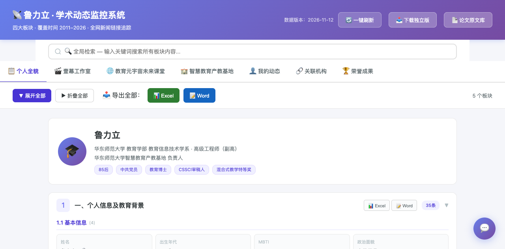

# 智慧教育 · 学术动态雷达

> 一个把「一个人的学术轨迹」从散落各处的网页、公众号、公示文件里收拢成结构化时间轴的本地看板。
> 面向高校教师、科研团队与产教融合平台，用一套纯 JSON + 单文件 HTML 的轻架构，把零散动态沉淀成可检索、可导出、可离线分发的档案。



---

## 这个项目解决什么问题

高校教师的公开动态天然是碎的：一篇论文在会议日程里，一次讲座在合作校的公众号里，一个获奖在主管部门的公示 PDF 里，一次调研在来访单位的通稿里。搜索引擎能搜到，但**存不下、串不起、没法按时间轴看**。

这套系统做了三件事：

1. **归集**：按主题（个人动态 / 教育元宇宙 / 产教基地 / 工作室学生成果 / 关联机构 / 荣誉）把每条动态落成一条带日期、出处链接、摘要的结构化事件。
2. **成档**：近 400 条事件按年份自动归档，支持关键词全局检索、按板块筛选、Excel / Word 一键导出。
3. **分发**：同一套数据既能在本地起 Flask 服务交互查看，也能构建成**单个 HTML 文件**（数据内嵌、离线可用），直接发给同行或挂到静态托管上。

## 功能

| 模块 | 说明 |
|---|---|
| 七大板块 | 个人全貌 / 壹幕工作室 / 教育元宇宙未来课堂 / 智慧教育产教基地 / 个人动态 / 关联机构 / 荣誉与成果 |
| 全局检索 | 一次输入，跨全部板块与全部年份查找，命中结果直接跳转到所属时间轴 |
| 时间轴归档 | 每条事件含日期、标题、来源、链接、摘要、分类标签，支持折叠与展开 |
| Excel / Word 导出 | 服务端用 openpyxl / python-docx 生成，按板块或按子表分别导出 |
| 论文原文库 | 论文列表 + 本地 PDF 原文，题目与出处一一对应 |
| 一键刷新 | 触发一次在线检索，把新发现的条目合并去重后写回 JSON |
| 独立版构建 | 把全部数据内嵌进 HTML，产出可离线打开、可直接分发的单文件看板 |
| 双份数据校验 | `results/` 与 `static/` 保持完全一致，避免静态资源与接口数据不同步 |

## 快速开始

```bash
git clone https://github.com/lll19890928-hash/smartedu.git
cd smartedu
python3 -m venv venv && source venv/bin/activate
pip install -r requirements.txt

# 可选：启用页面右下角的 AI 问答（不填则其余功能不受影响）
cp .env.example .env   # 填入自己的 DEEPSEEK_API_KEY

python server.py
```

打开 <http://localhost:8890>。

不想装环境也可以直接用浏览器打开仓库根目录的 `index.html`——那是构建好的独立版，数据已经内嵌，断网也能看。

## 目录结构

```
smartedu/
├── server.py                  # Flask 主服务（检索 / 导出 / 刷新 / 独立版构建）
├── build_standalone.py        # 独立版构建脚本，产出 index.html
├── requirements.txt
├── index.html                 # 构建产物：单文件独立版（GitHub Pages 入口）
├── results/                   # 主数据（结构化事件 JSON）
│   ├── _meta.json             # 总览：更新时间、事件总数、各板块条目数
│   ├── profile.json           # 个人档案：基本信息 / 教学 / 科研 / 获奖 / 培训
│   ├── lulili.json            # 个人动态时间轴
│   ├── metaverse.json         # 教育元宇宙未来课堂
│   ├── base.json              # 智慧教育产教基地
│   ├── yimu.json              # 壹幕工作室与学生成果
│   ├── related.json           # 关联机构与学术动态
│   └── honors.json            # 荣誉与成果
├── static/                    # 前端资源 + 数据镜像（与 results/ 内容一致）
│   ├── dashboard.html         # 看板模板
│   ├── papers/                # 论文 PDF 原文
│   └── certificates/          # 获奖证书
└── docs/preview.png           # README 预览图
```

## 数据格式

每个板块是一份同构的 JSON：

```json
{
  "topic": "鲁力立个人动态",
  "total": 75,
  "results": [
    {
      "date": "2026-11-08",
      "title": "ChinaVR 2026 会议论文口头报告",
      "category": "学术会议",
      "summary": "在「虚实交互与应用」专场报告……",
      "link": "https://..."
    }
  ]
}
```

约定的两条规则：

- **日期统一 `YYYY-MM-DD`**，缺日期的条目不进时间轴，只留在档案区块里。
- **`results/` 与 `static/` 必须同步**：前者供接口读取，后者供静态页面读取。改一份就要改另一份，否则页面与接口会打架。

## 更新机制

数据更新走「检索 → 合并 → 校验」三步：

```bash
# 1. 检索结果先落到临时文件，格式见下
# 2. 合并脚本按 URL + 标题双重去重后写入对应板块
python3 results/_merge_findings_YYYY-MM-DD.py
# 3. 重建独立版，让 index.html 跟上最新数据
python3 build_standalone.py
```

临时检索结果的格式：

```json
[{"query": "关键词", "title": "标题", "url": "链接", "snippet": "摘要", "date": "日期", "found_at": "检索时间"}]
```

服务运行中也可以直接点右上角的「一键刷新」，走 `POST /api/refresh`。

## 主要接口

| 接口 | 作用 |
|---|---|
| `GET /api/topics` | 板块清单 |
| `GET /api/search?topic=lulili` | 按板块取事件 |
| `GET /api/global_search?q=关键词` | 跨板块检索 |
| `GET /api/export?topic=...&fmt=xlsx` | 导出 Excel / Word |
| `POST /api/refresh` | 触发一轮在线检索 |
| `GET /api/meta` | 数据版本与统计 |
| `GET /standalone` | 下载单文件独立版 |

## 技术栈

后端 Flask + 标准库 urllib 抓取，前端原生 JS（无框架、无 CDN 依赖），数据层就是文件系统——没有数据库，克隆下来就能跑，改一个 JSON 立刻生效。

## 关于数据

仓库中的档案内容来自公开网页、高校与政府官网、公众号通稿及公开公示文件，每条事件都保留了出处链接；论文 PDF 与证书图片的著作权归原出版方或本人所有，**仅供学术交流与教学参考，不作商业使用**。

如需引用或转载本仓库中的个人履历内容，请注明来源。如认为某条记录存在事实错误或不应公开，请在 Issues 中提出，会尽快核实处理。

## License

代码部分采用 MIT 协议；档案数据与图片资料不在协议授权范围内。
